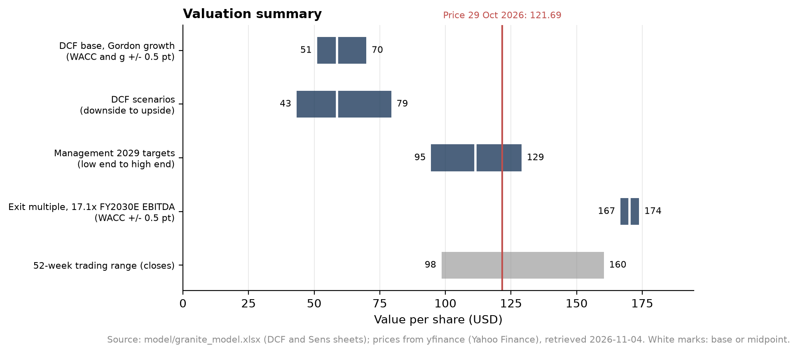
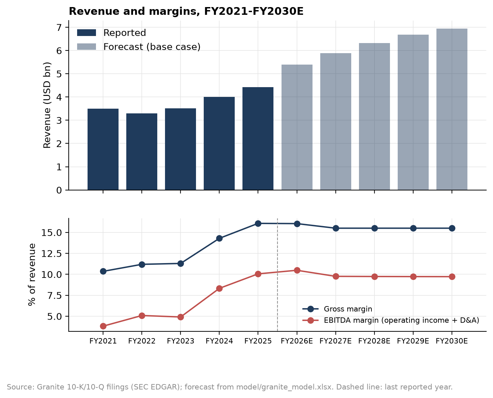

# Granite Construction: three-statement model and DCF

A five-year forecast and DCF for Granite Construction (NYSE: GVA), a US civil contractor with its own aggregates and asphalt business. Everything is built from the company's SEC filings and public market data, with a valuation date of 29 Oct 2026, the day the Q3 10-Q came out. My base case gives **USD 58.72 per share**, against a share price of USD 121.69 (−52%). A reverse DCF shows the price is roughly what the model gives if Granite meets the middle of the 2029 targets it announced that day: 11% organic growth a year and a 15% adjusted EBITDA margin.

## Question

I work in finance at a construction contractor, where I prepare progress payment claims. Granite recognises revenue the same way, as work progresses, and its cash flow depends on the same things I deal with every day: retention, billing timing and claims. I chose it because I felt I could judge its numbers better than those of a company in a sector I don't know.

I wanted to find out what Granite is worth on assumptions I can defend from its own filings, and, if that differs from the market price, which assumptions explain the gap.

## Data

All financial statement figures come from Granite's 10-K and 10-Q filings on [SEC EDGAR](https://www.sec.gov/cgi-bin/browse-edgar?action=getcompany&CIK=0000861459&type=10-K). I read them from the inline XBRL tags in each filing, so every number in the model can be traced to a tag and an accession number. `data/SOURCES.md` has the details.

The history starts in **FY2021**, not earlier. Granite restated FY2017 and FY2018 (and the quarters of 2018 and 2019) in its FY2019 10-K, after an Audit Committee investigation found that Heavy Civil project forecasts had been too optimistic. FY2019 and FY2020 were filed while the control weaknesses behind that restatement were still open, so I didn't want to build forecasts on them. FY2021 is the first year with effective controls.

That leaves five years of history (FY2021 to FY2025) plus H1 and 9M 2026. Before building anything I checked that my condensed statements add up to every subtotal in the filings and agree with the SEC's companyfacts API. All 176 checks match exactly (`outputs/tables/reconciliation.csv`).

Market and cost-of-capital data come from Damodaran's datasets (betas, implied ERP, industry multiples, synthetic ratings), FRED (10-year Treasury yield, FOMC long-run projections) and yfinance for the share price.

## Methodology

The workbook (`model/granite_model.xlsx`) is built by `src/model/build_excel.py`. Blue cells are inputs or reported figures, and black cells are formulas. Every assumption is explained in [ASSUMPTIONS.md](ASSUMPTIONS.md), section by section.

- Revenue: FY2026E is the low end of guidance (USD 5.4bn). FY2027E Construction revenue is anchored on backlog: committed and awarded projects at 30 Sep 2026 × the share of September backlog that turned into next year's revenue in FY2023-25. That gives 9.0% growth, which then fades in a straight line to 4% by FY2030E. The 4% comes from the Fed's long-run projections (2% real growth plus 2% inflation).
- Margins: Gross margin is 15.5% from FY2027E. This is FY2025 and 9M 2026 with the net effect of project estimate revisions removed (10-K/10-Q Note 3). FY2026E uses the 9M actual plus a Q4 at last year's Q4 margin. SG&A is 8.75%, the top of guidance, with SBC treated as a real cost.
- Reinvestment: Net investment is tied to growth through Granite's sales-to-capital ratio (3.87, excluding goodwill and intangibles). Capex is whatever is left after working capital. In the terminal year, reinvestment = g / RONIC of NOPAT, with RONIC at Granite's own FY2022-25 average return on capital (9.7%).
- Cost of capital:
  - WACC is 8.93%.
  - The beta is bottom-up: Damodaran's industry betas for Engineering/Construction and Construction Supplies, weighted by the estimated value of each segment, then relevered at Granite's market D/E of 28.8%.
  - The risk-free rate is the 10-year Treasury on the valuation date (4.98%). The ERP is Damodaran's implied ERP for 1 Oct 2026 (4.20%).
  - The cost of debt is 6.63%: the Treasury yield on the valuation date plus the credit spread on Granite's 6.375% 2034 notes. I took the spread from the 10-Q fair value, because the notes are a private 144A issue with no public CUSIP. A synthetic rating from interest coverage is the cross-check.
- DCF: FCFF from 1 Oct 2026. The Q4 stub is FY2026E minus 9M actual, discounted mid-period from the valuation date. Gordon growth is the main terminal value. An exit multiple (Damodaran's industry EV/EBITDA, adjusted for leases) is a cross-check only.
- Equity bridge: Debt at market value. The 2030 convertibles are counted at principal, and their dilution is net of Granite's capped call, recalculated from the share price.
- Sens sheet: the WACC × g and WACC × exit multiple tables (live formulas), the scenarios, and a reverse DCF solved with Goal Seek.

## Key results

| | Value per share (USD) | vs price (121.69) |
|---|---|---|
| Downside (no Construction growth in FY2027E, gross margin 14.5%) | 43.28 | −64% |
| **Base case (Gordon growth)** | **58.72** | **−52%** |
| Upside (gross margin implied by FY2026 guidance) | 79.37 | −35% |
| Management 2029 targets, midpoint (range 94.55-129.02) | 111.38 | −8% |
| Exit multiple cross-check (17.1x FY2030E EBITDA) | 170.20 | +40% |

How the base case gets from enterprise value to equity value (USD m):
- Enterprise value: 3,629, of which 80% is terminal value.
- Net debt and other claims: −1,004.
- Equity value: 2,625, or 44.70m diluted shares × USD 58.72.

The Gordon value implies 6.5x FY2030E EBITDA, against 17.1x for the industry, and the industry multiple would imply 8.6% growth forever. On its own, the price would need a gross margin of 20.0% from FY2027E. No terminal return on capital is high enough to reach it: even with no terminal reinvestment the value is USD 104.66.





## Interpretation

My base case gives about $59 per share, well below the $121.69 price on 29 Oct. The reverse DCF shows why: the price is roughly what you get if Granite hits the middle of its 2029 targets (about 11% organic growth and a 15% adjusted EBITDA margin) and then slows to 4%. That needs a gross margin of about 18-19%, above anything Granite reported in FY2021-25 (10.4-16.1%). So the gap is mostly a question of whether management delivers its margin targets. The record backlog supports the growth part. Granite's history of optimistic project forecasts, and the open question on federal highway funding, make me cautious about the margin part. I read the current price as leaving little room for error rather than as clearly wrong.

## Limitations and what I'd do next

- Short history: Five years is less than a full construction cycle, and FY2021 to FY2025 covers the ramp-up in federal infrastructure spending. Average margins and working-capital days from this window may not be normal levels, so the forecast leans on them less than it otherwise would.
- Restatement history: The 2017 to 2019 restatement and the 2022 tax-related weakness are a reminder that a contractor's reported margins depend on project cost estimates. The model can't test those estimates; it takes the audited figures as given.
- Forecast statements: The forecast is built as operating schedules (the Sched sheet) that drive FCFF. The IS, BS and CF sheets hold the five reported years. A full forecast balance sheet and cash flow statement with a debt schedule is not built yet, so net income and EPS aren't forecast.
- Cost of debt: The credit spread comes from the 30 Sep fair value in the 10-Q, not from a trade on the valuation date. It's assumed clean of accrued interest; if it wasn't, the cost of debt would be about 0.4 points higher.
- One margin for both segments: Construction and Materials grow on one path and share one gross margin. In 9M 2026 Materials earned less than Construction (15.9% against 16.7%), so a split would matter.
- Things left out on purpose: Amortisation of the 2026 acquisitions' intangibles (no useful lives disclosed yet; tax effect only). Future acquisitions, which Granite plans but which cost money.
- Next: Build the forecast statements and the debt schedule. Then compare the valuation with the trading comparables in project 2.

## How to reproduce

```
cd 01-three-statement-dcf
python -m src.run
```

This downloads the filings and market data (needs `SEC_EMAIL` and `FRED_API_KEY` in the repo's `.env`), rebuilds the statements in `data/processed/`, prints the reconciliation, writes `model/granite_model.xlsx` and draws the charts in `outputs/figures/`. The model step opens the workbook in Excel to recalculate it, run the checks and solve the reverse DCF with Goal Seek, so it needs Excel on Windows. Downloads are cached; add `--refresh` to `python -m src.data.download_sec` or `download_market` to fetch them again.

A two-page summary is in `report/granite_dcf_summary.pdf`.
